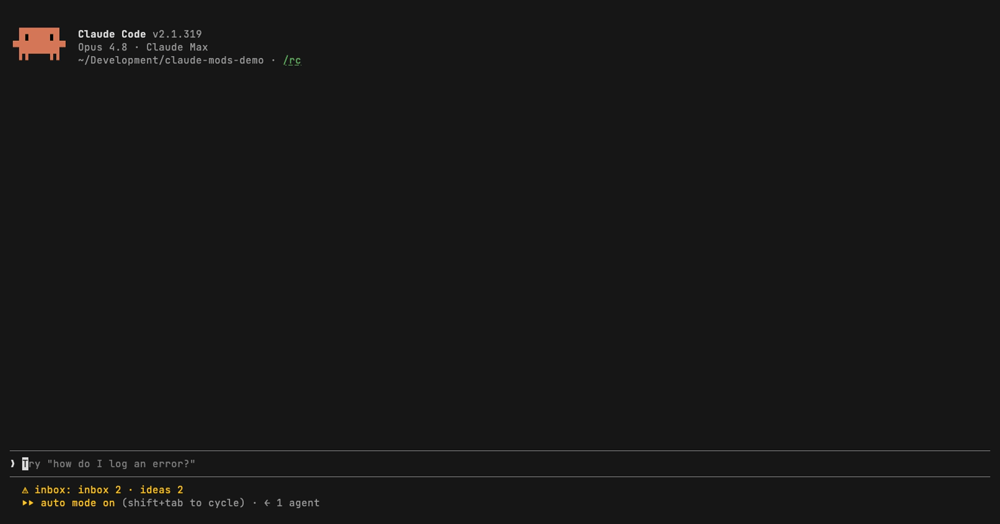

# claude-mods

Small mods that make long Claude Code sessions easier to steer. Install one, both, or neither: each is a standalone plugin in this marketplace.

| Mod | What it does |
|---|---|
| [inbox](inbox/README.md) | Claude files the questions it asks mid-task in an inbox pane instead of burying them in scrollback, and keeps a per-project ideas list. |
| [gh-helper](gh-helper/README.md) | A side pane with the GitHub issues and PRs waiting for you, the In progress items of a GitHub Project, and open PRs. |

## inbox


Claude is running three subagents and needs you to pick between two migration strategies. Without the mod, that question scrolls away under tool output. With it, the question lands in a pane with a subject line and enough context to answer later, even from another session, and Claude carries on with the work that doesn't depend on it. [More →](inbox/README.md)

## gh-helper



Label an issue `to-claude` and it shows up beside your session. Below it: what your team has In progress on the project board, and the open PRs. Refreshes every 5 minutes through the `gh` CLI. [More →](gh-helper/README.md)

## Requirements

- Claude Code with mods support (the `hooks.json` `modules` API). Last tested on 2.1.319.
- gh-helper only: the [`gh` CLI](https://cli.github.com/), authenticated with the `project` scope.

## Install

```sh
claude plugin marketplace add emreerkan/claude-mods
claude plugin install inbox@claude-mods
claude plugin install gh-helper@claude-mods
```

Or from inside Claude Code: `/plugin marketplace add emreerkan/claude-mods`, then `/plugin install inbox@claude-mods`.

Update with `claude plugin update inbox@claude-mods`. See the [changelog](CHANGELOG.md) for what changed.

## What these mods do to your session

Read this before you install:

- **inbox adds instructions to every session's system prompt** (about 1.7 KB, roughly 400 tokens) that tell Claude when to use its inbox and ideas tools. It changes how Claude asks questions. `claude plugin details` doesn't count it. The full text is the `SYSTEM` constant at the top of [`inbox/hooks/register.tsx`](inbox/hooks/register.tsx).
- **gh-helper runs `gh` every 5 minutes** while a session is open, against the owner or repository you configure. It adds nothing to the prompt.
- Neither mod sends data anywhere except GitHub (gh-helper, through your own `gh`).

## Contributing

Bug reports and PRs are welcome. See [CONTRIBUTING.md](CONTRIBUTING.md) for the dev loop and tests.

## License

[MIT](LICENSE)
