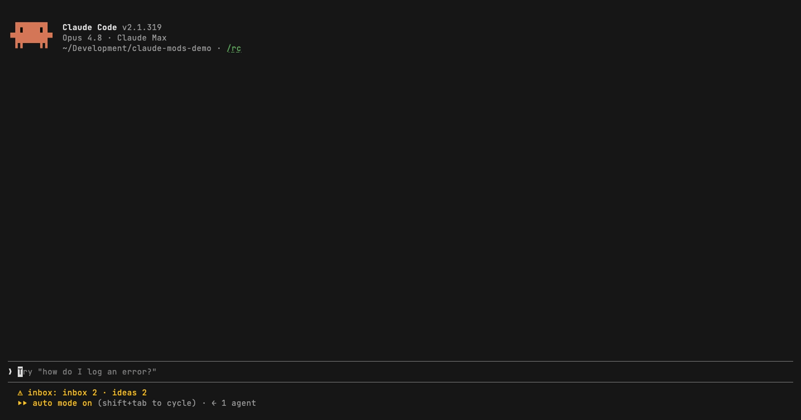

# gh-helper

A Claude Code side pane that shows the GitHub work waiting for you.

<!-- Screen recording placeholder. Save the GIF as ../docs/media/gh-helper.gif and uncomment:

-->

The idea: you pick a **routing label** (for example `to-claude`). Anyone on the team who wants something handled in your Claude sessions puts that label on an issue or PR. Those items are your **pings**, and they sit at the top of the pane until they are closed, merged or unlabeled.

The pane has three sections:

- **Pings:** open issues and PRs in an organization (or one repository) that carry the routing label.
- **In progress:** items whose Status is "In progress" on a GitHub Project of that organization, with assignees. Epics (label `epic`) are counted, not listed.
- **Open PRs:** open PRs in that organization that are on the same GitHub Project, with author and draft marker.

## Requirements

An authenticated [`gh` CLI](https://cli.github.com/) with the `project` scope:

```sh
gh auth refresh -s project
```

## Install

```sh
claude plugin marketplace add emreerkan/claude-mods
claude plugin install gh-helper@claude-mods
```

## Use

- `/gh-helper <owner>[/<repo>] <label> [project-number]` saves the setting for the current working directory and opens the pane. Example: `/gh-helper my-org to-claude 1`. Sessions started in that directory, or in any folder below it, use it automatically.
- With `owner/repo` every section covers that one repository; the project still belongs to the owner, and its draft items are left out.
- `/gh-helper <owner>/<repo>` with no label is repo-only mode: that repository's open issues and open PRs, with no pings and no project.
- `/gh-helper` with no arguments opens the pane with the saved setting.
- The status line shows the number of open pings. The pane opens by itself at session start when the terminal is at least 144 columns wide.

### Keys

| Key | Action |
|---|---|
| `r` | Refresh now |
| `✓` (button) | Hide a ping until it has new activity |
| `u` | Show hidden pings again ("N done · show") |

## How it fetches

It refreshes every 5 minutes with `gh`. Sessions on the same setting share one fetch per period (cached in the plugin store), and the In progress query asks GitHub for those items only, so a refresh costs a few GraphQL points rather than one per board item. On a rate limit the pane keeps the last result and pauses until the limit resets.

gh-helper adds nothing to the system prompt.

## Data

Settings, the last fetch and hidden pings live in the plugin store. Uninstalling removes nothing else:

```sh
claude plugin uninstall gh-helper@claude-mods
```
