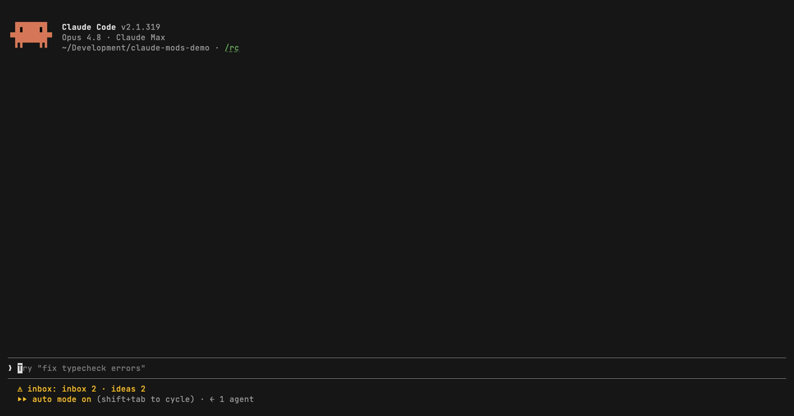

# inbox

A project-bound inbox for the questions Claude asks while it keeps working.

<!-- Screen recording placeholder. Save the GIF as ../docs/media/inbox.gif and uncomment:

-->

When Claude needs a decision from you but has other work running (subagents, workflows, pending tasks), a question in prose scrolls away. This mod gives Claude an `inbox_ask` tool instead: the question lands in an inbox pane with a subject and a self-contained body, and Claude carries on with work that doesn't depend on the answer.

It also keeps an ideas list. Say "idea: …" or "what if we someday …" and Claude records it with `idea_add` without starting on it. Ideas are marked done when the work is built and verified, and done ideas are purged after 7 days.

## Install

```sh
claude plugin marketplace add emreerkan/claude-mods
claude plugin install inbox@claude-mods
```

## Use

- `/inbox` opens the pane: open questions above, ideas below. `/ideas` opens it on the ideas.
- Open items are bound to the project (the git root, or the nearest folder with `.claude/` or `CLAUDE.md`), so a question asked in one session can be answered in a later one.
- The status line shows the number of open questions and open ideas (`inbox 2 · ideas 3`).

### Keys

| Key | Questions | Ideas |
|---|---|---|
| `s` | Switch to ideas | Switch to questions |
| `r` | Reply: quotes the item into the prompt as `[inbox #N]`; sending resolves it | Discuss: quotes the idea as `[idea #N]` |
| `d` | Dismiss without replying | Delete |
| `e` | | Edit |
| `m` | | Mark done / reopen |
| `v` | | Move an idea from another project here |
| `a` | | Toggle this project / all projects |
| `j` / `k` | Next / previous | Next / previous |

## What it adds to your prompt

Every session gets an `# Inbox` and `# Ideas` section in its system prompt (about 1.7 KB, roughly 400 tokens) that tells Claude when to call the four tools: `inbox_ask`, `inbox_resolve`, `idea_add`, `idea_done`. The exact text is the `SYSTEM` constant in [`hooks/register.tsx`](hooks/register.tsx). If you don't want this in a session, disable the plugin for that project with `claude plugin disable inbox@claude-mods --scope project`.

## Data

- Questions: the plugin store, keyed by project.
- Ideas: `~/.claude/ideas.json`, shared by all projects.

## Remove

```sh
claude plugin uninstall inbox@claude-mods
rm ~/.claude/ideas.json   # optional: uninstalling keeps your ideas
```
